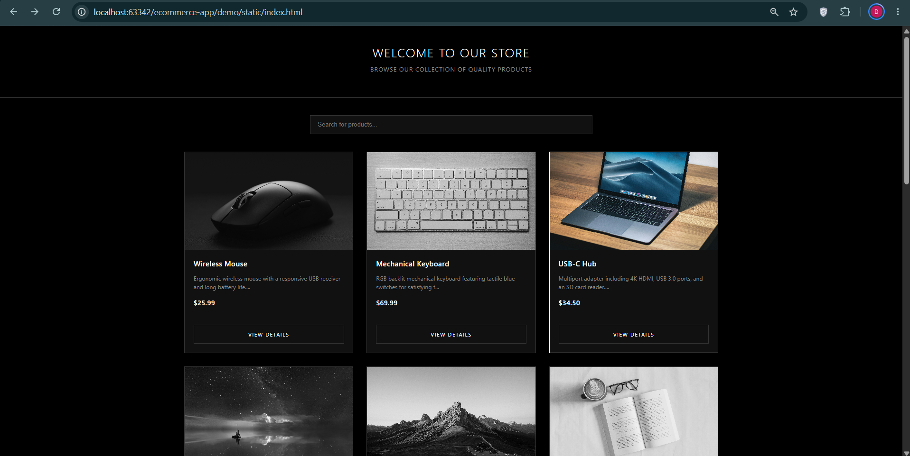
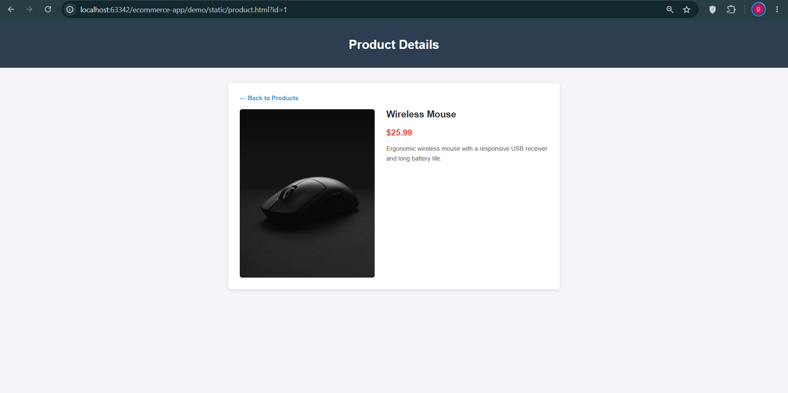

# Full-Stack E-Commerce Application — Part 1: Product Listing Website

A full-stack, minimalist e-commerce application built with a **Spring Boot** backend, **MySQL** relational database with Hibernate/JPA, and a responsive **HTML5/CSS3/JavaScript** frontend.

---

## 🏛️ Application Architecture

The application follows a traditional 3-tier architecture:

```
+-------------------------------------------------------------+
|                      PRESENTATION TIER                      |
|  Single-Page / Static Web Application (HTML, CSS, JS)       |
|  - index.html (Catalog View & Search Filter)               |
|  - product.html (Detailed Specimen View)                    |
+------------------------------+------------------------------+
                               | HTTP Fetch Requests (REST)
                               v
+-------------------------------------------------------------+
|                        APPLICATION TIER                     |
|  Spring Boot Web Server (Port 8080)                         |
|  - ProductController (REST API Endpoints)                   |
|  - ProductRepository (Spring Data JPA / Hibernate)          |
|  - Product (Entity Model)                                   |
+------------------------------+------------------------------+
                               | JDBC Connection / SQL Queries
                               v
+-------------------------------------------------------------+
|                          DATA TIER                          |
|  MySQL Relational Database                                  |
|  - Database: ecommerce_db                                   |
|  - Table: products                                          |
+-------------------------------------------------------------+
```

1. **Frontend (Presentation Tier):** Standard HTML, CSS, and vanilla JS served statically by Spring Boot from `src/main/resources/static/`. It makes async REST API calls via `fetch()` to retrieve product catalog and details dynamically.
2. **Backend (Application Tier):** Spring Boot REST API layer handling validation, business logic, and object-relational mapping (ORM) using Hibernate/JPA.
3. **Database (Data Tier):** MySQL storing catalog entities.

---

## ⚙️ Prerequisites

Ensure you have the following installed on your machine before running the application:

* **Java Development Kit (JDK):** Version 17 or higher
* **MySQL Server:** Version 8.0 or higher
* **IDE:** IntelliJ IDEA (Community or Ultimate) or VS Code
* **Build Tool:** Apache Maven (bundled with IntelliJ)
* **Web Browser:** Google Chrome, Brave, Mozilla Firefox, or Safari

---

## 🗄️ Database Setup & Initialization

### 1. Schema Creation Script
Connect to your local MySQL instance (e.g., via MySQL Workbench, IntelliJ Database Tool, or MySQL CLI) and execute:

```sql
-- Create Database
CREATE DATABASE IF NOT EXISTS ecommerce_db;

-- Use Database
USE ecommerce_db;

-- Create Products Table
CREATE TABLE IF NOT EXISTS products (
    id INT AUTO_INCREMENT PRIMARY KEY,
    name VARCHAR(255) NOT NULL,
    description TEXT,
    price DECIMAL(10, 2) NOT NULL,
    image_url VARCHAR(500),
    created_at TIMESTAMP DEFAULT CURRENT_TIMESTAMP
);
```

### 2. Sample Data Insertion Script
Execute the following script to populate the database with sample products:

```sql
USE ecommerce_db;

-- Clear existing data (optional)
TRUNCATE TABLE products;

-- Seed Sample Products
INSERT INTO products (name, description, price, image_url) VALUES
('Singing Ringing Tree', 'A wind-powered sound sculpture constructed of galvanized steel pipes, set in the Lancashire landscape.', 125000.00, 'https://images.unsplash.com/photo-1508739773434-c26b3d09e071'),
('Voynich Manuscript Facsimile', 'A high-definition replica of the mysterious 15th-century text written in an unknown script.', 450.00, 'https://images.unsplash.com/photo-1544716278-ca5e3f4abd8c'),
('Aerogel Sample', 'Known as "solid smoke," this extremely low-density synthetic material is the world-best thermal insulator.', 85.50, 'https://images.unsplash.com/photo-1635070041078-e363dbe005cb'),
('Bismuth Crystal', 'A lab-grown metal crystal famous for its iridescent rainbow colors and stepped hopper crystal structure.', 28.00, 'https://images.unsplash.com/photo-1618005182384-a83a8bd57fbe'),
('Meteoric Iron Fragment', 'A genuine piece of the Gibeon meteorite, composed of iron-nickel alloy with a distinct Widmanstätten pattern.', 310.00, 'https://images.unsplash.com/photo-1614728894747-a83421e2b9c9'),
('Vantablack Vials', 'Sample of the super-black coating that absorbs 99.96% of visible light, making 3D objects look like 2D voids.', 150.00, 'https://images.unsplash.com/photo-1579546929518-9e396f3cc809');
```

---

## 🛠️ Backend Configuration (`application.properties`)

Ensure `src/main/resources/application.properties` contains your database connection details:

```properties
server.port=8080

# Database Configuration
spring.datasource.url=jdbc:mysql://localhost:3306/ecommerce_db?useSSL=false&serverTimezone=UTC
spring.datasource.username=root
spring.datasource.password=YOUR_MYSQL_PASSWORD

# JPA / Hibernate Properties
spring.jpa.hibernate.ddl-auto=update
spring.jpa.show-sql=true
spring.jpa.properties.hibernate.dialect=org.hibernate.dialect.MySQLDialect
```

---

## 📡 REST API Endpoint Documentation

| Method | Endpoint | Query Params | Description | HTTP Status Codes |
| :--- | :--- | :--- | :--- | :--- |
| `GET` | `/api/products` | `search` *(optional)* | Retrieves full product list. Filters by name or description if search query parameter is provided. | `200 OK`, `500 Internal Server Error` |
| `GET` | `/api/products/{id}` | None | Retrieves detailed information for a single product by its unique ID. | `200 OK`, `404 Not Found`, `500 Internal Server Error` |

### Sample Responses

#### `GET /api/products`
```json
[
  {
    "id": 1,
    "name": "Singing Ringing Tree",
    "description": "A wind-powered sound sculpture constructed of galvanized steel pipes, set in the Lancashire landscape.",
    "price": 125000.0,
    "imageUrl": "https://images.unsplash.com/photo-1508739773434-c26b3d09e071"
  }
]
```

#### `GET /api/products/1`
```json
{
  "id": 1,
  "name": "Singing Ringing Tree",
  "description": "A wind-powered sound sculpture constructed of galvanized steel pipes, set in the Lancashire landscape.",
  "price": 125000.0,
  "imageUrl": "https://images.unsplash.com/photo-1508739773434-c26b3d09e071"
}
```

---

## 🚀 How to Run locally (IntelliJ IDEA)

1. **Start MySQL Server:** Ensure your local MySQL instance is running.
2. **Open Project:** Open the project directory in IntelliJ IDEA.
3. **Configure Database Connection:** Update `src/main/resources/application.properties` with your MySQL password.
4. **Run Application:**
   * Locate `DemoApplication.java` (or main Spring Boot class inside `src/main/java/...`).
   * Click the green **Play** button next to `main()` method, or run using Maven in terminal:
     ```bash
     mvn spring-boot:run
     ```
5. **Access Application in Browser:**
   * **Product Catalog Page:** [`http://localhost:8080/index.html`](http://localhost:8080/index.html) (or simply [`http://localhost:8080`](http://localhost:8080))
   * **Product Details View:** [`http://localhost:8080/product.html?id=1`](http://localhost:8080/product.html?id=1)

---

## 📁 Git Repository Structure

```text
ecommerce-app/
├── schema.sql                           # Database schema and seed script
├── README.md                            # Comprehensive documentation
└── backend/                             # Spring Boot Project Root
    ├── pom.xml                          # Maven dependencies
    └── src/
        ├── main/
        │   ├── java/com/example/ecommerce/
        │   │   ├── controller/
        │   │   │   └── ProductController.java
        │   │   ├── model/
        │   │   │   └── Product.java
        │   │   ├── repository/
        │   │   │   └── ProductRepository.java
        │   │   └── EcommerceApplication.java
        │   └── resources/
        │       ├── application.properties
        │       └── static/             # Static Frontend Assets
        │           ├── index.html      # Catalog & Search UI
        │           └── product.html    # Product Details UI
```

---

## 📸 Screenshots

### 1. Product Listing & Search View


### 2. Product Details View
